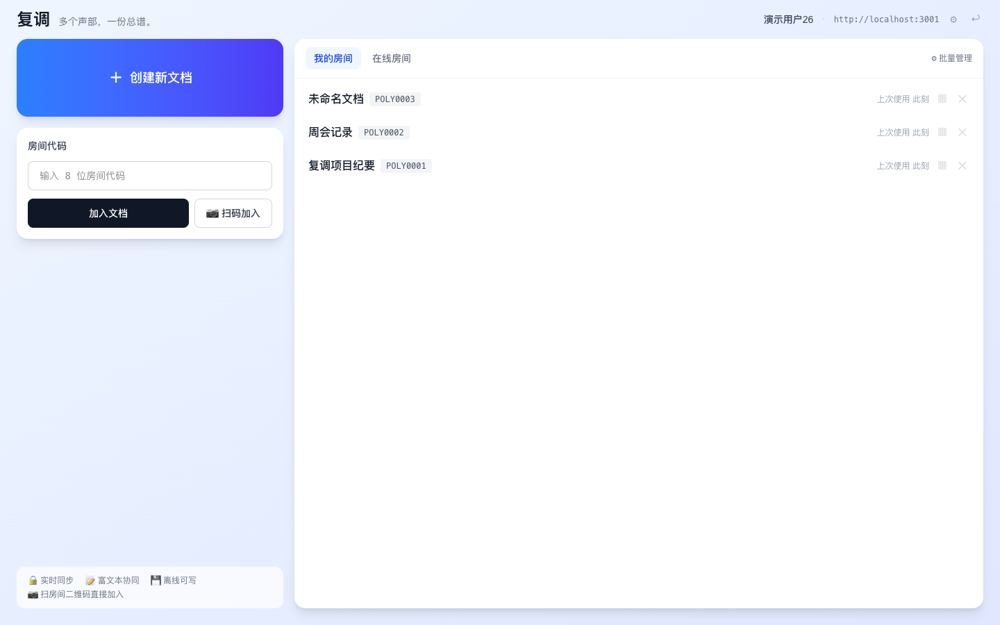
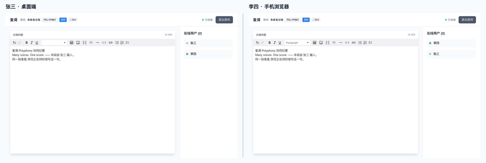

<div align="center">

# 复调 Polyphony

**Many voices. One score.**

实时协同文档编辑 · 自托管 · 全平台

[](https://github.com/kkaaddff/polyphony/releases)
[](LICENSE)
[](#-快速开始)

**「复调」取自巴赫的赋格:多个独立声部各行其是、没有中央指挥,却收敛为一份和谐的总谱——这正是 CRDT 协同编辑的语义:每个人自由编辑,文档最终一致。**

</div>

---



基于 [Yjs](https://github.com/yjs/yjs) CRDT 的实时协同富文本编辑器。一套 React 代码构建 **Web / 桌面(macOS·Windows·Linux)/ Android** 客户端;服务器是一个单容器 Node 服务,`docker compose up -d` 即完成自托管。**账号 token 登录**(web 注册、全端通用),首页双栏一屏;手机**扫码直接进房**,断网可写、重连自动合并。



## ✨ 特性

- 🎼 **实时协同**——Yjs CRDT,多人并发编辑自动收敛、无冲突
- 📝 **富文本**——MDX 编辑器:加粗/斜体、列表、引用、表格、代码块、图片、链接
- 👤 **账号体系**——Web 端创建账号,token 一次性展示;桌面/Android 粘贴 token 登录;房间簿服务端同步,支持单个/批量退出
- 🚪 **房间系统**——8 位房间码进入;我的房间(跨端同步)/在线房间双列表;在线用户感知(awareness)
- 📱 **扫码进房**——房间二维码就是 Web URL,任何手机相机都能扫;App 内扫码走原生插件
- 💾 **离线可写**——IndexedDB 房间级持久化,断网继续编辑,恢复后自动合并
- 🖥 **桌面增强**——Tauri 2 托盘最近房间直达;Android arm64 安装包

## 🚀 快速开始

### 自托管(服务器 + Web,一条命令)

```bash
git clone https://github.com/kkaaddff/polyphony.git
cd polyphony
docker compose up -d
```

单容器同时提供「Web 前端 + 协同 WebSocket + 图片上传」,默认端口 `9091`:

```bash
curl http://127.0.0.1:9091/health
# {"status":"ok","totalRooms":0,"totalUsers":0,...}
```

上传图片持久化在具名卷 `polyphony-uploads`,账号数据(token 哈希 + 房间簿)在 `polyphony-data`,重建容器不丢数据。

### 创建账号并登录

1. 浏览器打开站点 → 首次进入「创建账号」:填用户名 → 创建;
2. **token 仅展示这一次**(复制保管好,丢了只能重建账号)——确认后即登录;
3. 桌面 / Android 客户端:同一引导页切到「已有账号 · 粘贴 token」,填服务器地址 + token 登录。

> 协同 WS、图片上传均要求有效 token;进入房间仍需 8 位房间码(双凭据:token = 身份,房间码 = 房间准入)。

<details>
<summary><b> HTTPS / 反向代理(WebSocket 升级配置)</b></summary>

裸 HTTP 直连 `http://IP:9091` 开箱即用;公网建议加一层反代。关键是 `/ws` 的升级头:

```nginx
server {
    listen 443 ssl;
    server_name docs.example.com;

    location / {
        proxy_pass http://127.0.0.1:9091;
        proxy_http_version 1.1;
        proxy_set_header Upgrade $http_upgrade;   # WebSocket 必需
        proxy_set_header Connection "upgrade";
        proxy_set_header Host $host;
        client_max_body_size 6m;                  # 图片上传 5MB 上限 + 头部余量
    }
}
```

</details>

### 桌面 / Android 客户端

到 [Releases](https://github.com/kkaaddff/polyphony/releases) 下载:

| 产物 | 说明 |
|---|---|
| `Polyphony_*_aarch64.dmg` | macOS(Apple Silicon) |
| `Polyphony_*_x64-setup.exe` | Windows(NSIS) |
| `Polyphony_*.AppImage` / `*.deb` | Linux |
| `app-universal-debug.apk` | Android(arm64) |

> 产物未签名/公证:macOS 首次打开需右键 → 打开;Windows 会弹 SmartScreen;apk 为 debug 签名可直接侧载。

客户端首次启动后在「设置」页填入服务器地址(如 `https://docs.example.com`)即可,运行时生效。

### 本地开发

```bash
./setup.sh              # client/ 与 server/ 各 npm install,写 .env.local
npm run dev:all         # 前端(Vite :5173) + WS 服务(:3001)
```

打开 <http://localhost:5173>。桌面/Android 壳开发(可选,需 Rust/JDK)见 [docs/README.md](docs/README.md)。

## 🏗 架构

```
 Tauri 桌面 (dmg/nsis/AppImage+deb)   托盘最近房间 · IndexedDB 离线缓存
 Tauri Android (arm64 apk)           扫码进房 · ws://IP:PORT 直连
 Web (Vite SPA)                      默认同源,?server= 可覆盖
        │  同一套 client/src(platform/ 收敛平台差异)
        ▼
 server/ Node —— express + y-websocket(CRDT 中继) + multer(上传) + /health
        ▲
 all-in-one Docker:同一端口托管静态前端 + WS(STATIC_DIR),单容器自托管
```

- **每个房间 = 一个 Yjs 文档**;服务端只中继不解析内容,房间状态在内存,重启清空,客户端从 IndexedDB 自动重同步。
- **服务器地址运行时解析**(`client/src/lib/serverConfig.ts`):`?server=` 参数 > 本机已保存配置 > dev 环境变量 > Web 同源回退——构建产物不含任何内联地址。
- **二维码 = Web URL**(`<server>/join?code=&server=`):系统相机扫码进 Web 版兜底,App 内扫码解析直连。

详细设计(协同内核、构建、测试、决策与踩坑记录)见 [`docs/`](docs/README.md)。

### HTTP 接口

| 接口 | 鉴权 | 说明 |
|---|---|---|
| `POST /auth/create` | 仅 Web/工具 | `{name}` → `{token, name}`;token **仅此一次**返回 |
| `GET /auth/me` | Bearer | 校验 token → `{id, name}` |
| `GET /rooms` | Bearer | 我的房间簿(含在线人数) |
| `POST /rooms/enter` | Bearer | `{code,name}` 登记/改名 upsert |
| `POST /rooms/leave` | Bearer | `{codes[]}` 批量退出 |
| `GET /health` | 公开 | `{ status, totalRooms, totalUsers, rooms }` |
| `POST /upload` | Bearer | `multipart/form-data`,字段 `image`,≤5MB → `{url:"/uploads/<name>"}` |
| `GET /uploads/*` | 公开 | 静态图片 |
| `ws://…/<房间码>?token=…` | token 参数 | y-websocket 协同通道,无效 token close(4001) |

## 📦 发布与 CI

- **`docker compose up -d`** 即部署(server + Web 一体机)——自建 Gitea CI 用同样方式自动构建部署,仓库内 [`.gitea/workflows/deploy.yml`](.gitea/workflows/deploy.yml) 可作自托管参考(纯文档推送不触发、验证失败自动回滚)。
- **桌面/Android 端产物**由 GitHub Actions 构建(`.github/workflows/build.yml`):推 `v*` tag 或手动触发,全产物挂 GitHub Release。

## 🔒 安全须知(如实)

- **双凭据模型**:token = 账号身份(服务端只存哈希),房间码 = 房间准入;二者缺一不可。无账号恢复机制——token 丢失只能重建账号,房间内容凭码仍可再进。
- 直连为明文 `ws://`(Android 已开 cleartext);公网使用请套 HTTPS 反代(见上文配置)。
- `/health` 会展示房间码与在线人数列表,介意暴露请在反代层屏蔽该路径。
- 账号仅支持 Web 端创建(服务端按 Origin 拦截 Tauri 客户端);其余端一律粘贴 token。

## 🙏 致谢

- [Yjs](https://github.com/yjs/yjs) / [y-websocket](https://github.com/yjs/y-websocket) / [y-indexeddb](https://github.com/yjs/y-indexeddb) —— CRDT 协同内核
- [MDX Editor](https://github.com/mdx-editor/editor) —— 富文本编辑器
- [Tauri](https://github.com/tauri-apps/tauri) —— 跨平台桌面/移动壳
- [Vite](https://github.com/vitejs/vite) / [React](https://github.com/facebook/react)

## 📄 许可证

[MIT](LICENSE) · 变更记录见 [CHANGELOG.md](CHANGELOG.md)
